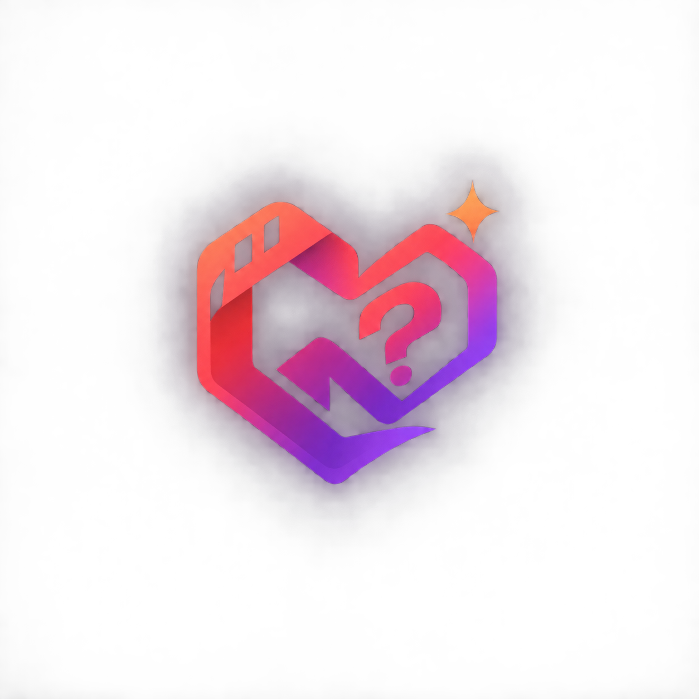
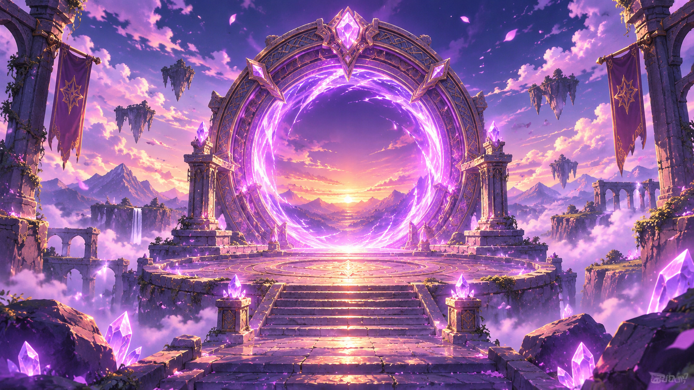
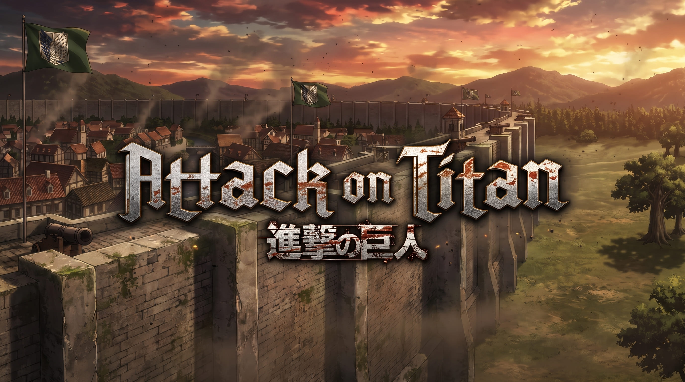
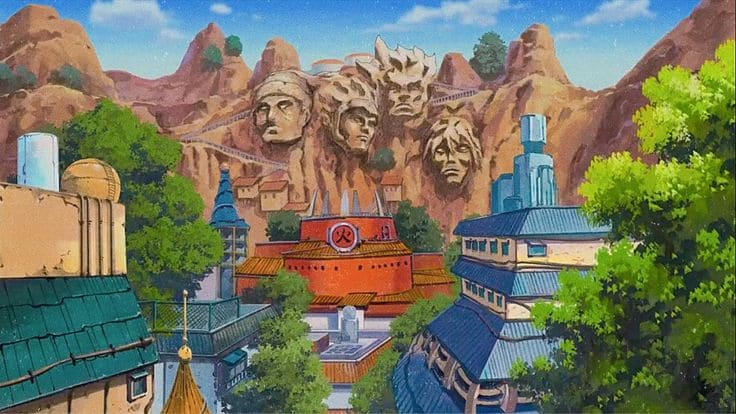
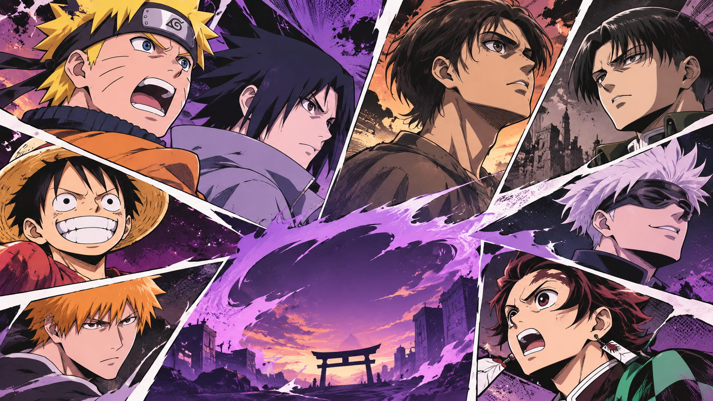
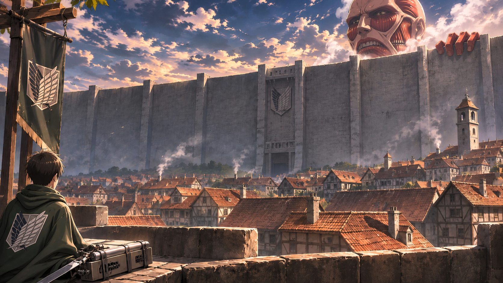
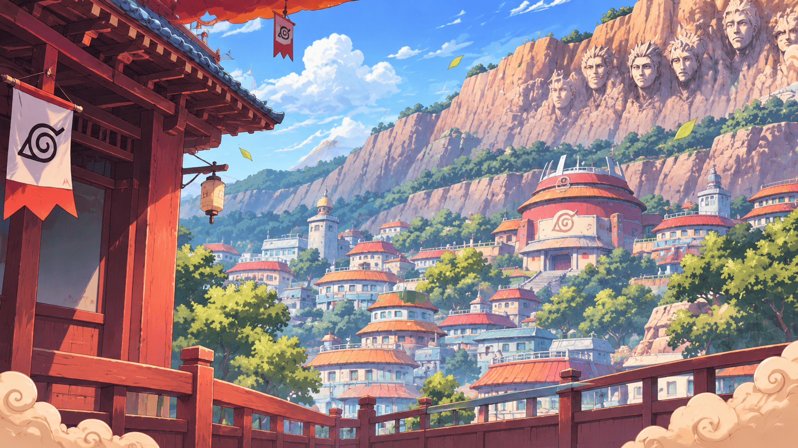
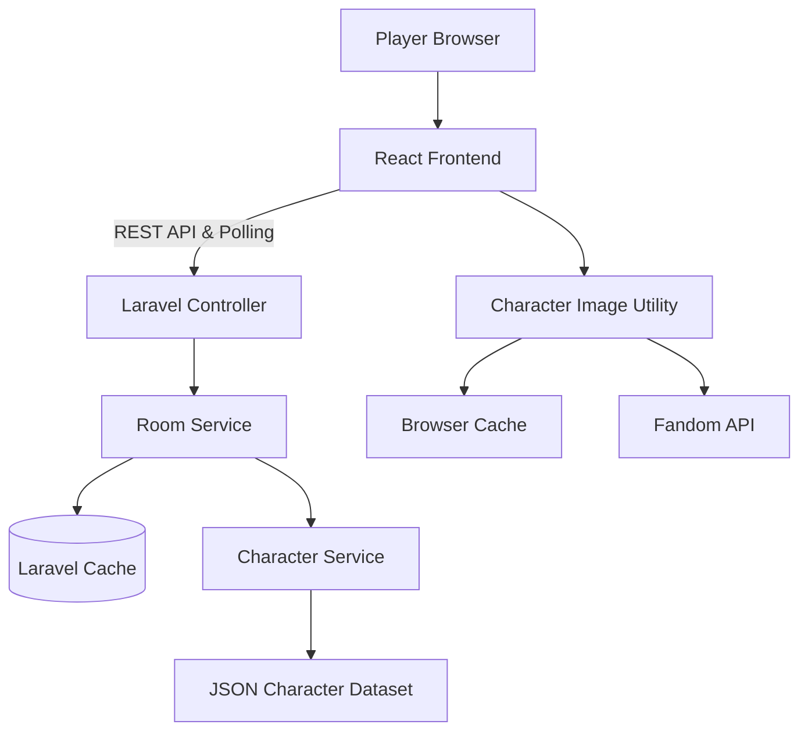

<div align="center">

  

  <h1>TEBAK KARAKTER</h1>

  <p>
    <strong>Guess your character. Challenge your friends. Become the champion.</strong>
  </p>

  <p>
    A multiplayer anime character guessing game.
  </p>

  <a href="https://tebak-karakter-tau.vercel.app/">
    
  </a>
  <a href="https://github.com/King-Rackka/Tebak-Karakter/issues">
    
  </a>

  <br><br>

  
  
  
  
  

  <br><br>

  

  <br><br>

  <a href="#-about-the-game">About</a> •
  <a href="#-features">Features</a> •
  <a href="#-anime-themes">Themes</a> •
  <a href="#-how-to-play">How to Play</a> •
  <a href="#-installation">Installation</a>

</div>

---

## 🎭 About the Game

**Tebak Karakter** adalah game multiplayer berbasis web yang menguji pengetahuan pemain tentang berbagai karakter anime.

Setiap pemain mendapatkan karakter rahasia yang hanya dapat dilihat oleh pemain lain. Pemain harus menebak identitas karakternya sendiri berdasarkan petunjuk yang diberikan oleh teman.

Kumpulkan poin, kalahkan temanmu, dan jadilah pemain terbaik!

> How well do you know your favorite anime?

## ✨ Features

| Feature | Description |
| :--- | :--- |
| 🎮 Multiplayer | Bermain bersama 2–8 pemain dalam satu room. |
| 🔑 Private Room | Bergabung menggunakan kode undangan. |
| 🌌 Anime Themes | Berbagai tema anime dengan visual yang unik. |
| 🎯 Difficulty | Easy, Medium, dan Hard. |
| 🛡️ Spoiler Protection | Filter karakter yang mengandung spoiler. |
| 🔄 Game Synchronization | Sinkronisasi permainan melalui polling. |
| 🖼️ Dynamic Images | Pengambilan gambar karakter melalui API. |
| 🏆 Leaderboard | Hasil ronde dan peringkat akhir pemain. |
| 📱 Responsive | Mendukung desktop dan perangkat mobile. |
| ⚙️ Custom Settings | Pengaturan tema, jumlah pemain, dan ronde. |

## 🌌 Anime Themes

Setiap tema memiliki koleksi karakter, background, warna, dan identitas visual tersendiri.

<table>
  <tr>
    <td width="33%" align="center">
      
      <h3>Attack on Titan</h3>
      <p>129 Characters</p>
      <p>Survey Corps, Warriors & Marley</p>
    </td>
    <td width="33%" align="center">
      
      <h3>Naruto Shippuden</h3>
      <p>192 Characters</p>
      <p>Shinobi, Akatsuki & Five Great Nations</p>
    </td>
    <td width="33%" align="center">
      
      <h3>Mix Semua</h3>
      <p>321 Characters</p>
      <p>Explore the Anime Multiverse</p>
    </td>
  </tr>
</table>

<div align="center">

| Total Anime Collections | Total Characters | Difficulty Levels |
| :---: | :---: | :---: |
| **2** | **321** | **3** |

</div>

*Jumlah karakter merupakan total dataset sebelum filter difficulty dan spoiler.*

More anime collections coming soon!

## 🎨 Theme Artwork

Setiap tema memberikan pengalaman visual yang berbeda selama permainan.

### Attack on Titan



### Naruto Shippuden



### Anime Multiverse


*Images above represent theme artwork, not gameplay screenshots.*

## 🕹️ How to Play

1. Masukkan nickname.
2. Buat room baru atau bergabung menggunakan room code.
3. Pilih tema anime, difficulty, dan jumlah ronde.
4. Undang teman untuk bergabung.
5. Lihat karakter milik pemain lain.
6. Berikan petunjuk kepada teman dan tebak karakter rahasiamu saat mendapatkan giliran.
7. Kumpulkan poin sebanyak mungkin.
8. Jadilah juara pada final leaderboard!

### Scoring System

Setiap pemain memiliki tiga kesempatan menebak dalam satu ronde.

| Attempt | Result | Points |
| :---: | :--- | ---: |
| 1st | Correct | +100 |
| 2nd | Correct | +60 |
| 3rd | Correct | +30 |
| Failed | Incorrect | 0 |

## 🛠️ Tech Stack

### Frontend

- React 19
- Tailwind CSS 4
- Vite 8
- Lucide React
- Canvas Confetti

### Backend

- Laravel 13
- PHP 8.3+
- REST API
- Laravel Cache
- Predis

### Data & Deployment

- JSON Character Dataset
- Fandom API
- Browser Local Storage
- Vercel

## 🏗️ System Architecture



## 📁 Project Structure

```text
Tebak-Karakter/
├── app/
│   ├── Http/
│   │   └── Controllers/
│   └── Services/
│       ├── CharacterService.php
│       └── RoomService.php
├── resources/
│   └── js/
│       ├── components/
│       ├── data/
│       ├── pages/
│       └── utils/
├── storage/
│   └── app/
│       └── characters/
├── public/
│   └── images/
│       ├── lobby-game/
│       └── setup/
├── routes/
├── tests/
├── composer.json
├── package.json
└── README.md
```

## 🚀 Installation

### Prerequisites

- PHP 8.3 or higher
- Composer
- Node.js compatible with Vite 8
- NPM
- SQLite PHP extension for the default local configuration

### 1. Clone Repository

```bash
git clone https://github.com/King-Rackka/Tebak-Karakter.git
cd Tebak-Karakter
```

### 2. Install Dependencies

```bash
composer install
npm install
```

### 3. Environment Configuration

```bash
php -r "file_exists('.env') || copy('.env.example', '.env');"
php artisan key:generate
```

### 4. Database Setup

```bash
php -r "file_exists('database/database.sqlite') || touch('database/database.sqlite');"
php artisan migrate
```

Configure the database and cache connection in `.env` if you use a different storage provider.

For multi-instance deployments, use shared cache storage that supports atomic locks.

### 5. Run Application

Run the backend:

```bash
php artisan serve
```

Run the frontend in another terminal:

```bash
npm run dev
```

Open:

```text
http://localhost:8000
```

### 6. Run Tests

```bash
php artisan test
```

## 🗺️ Roadmap

- [x] Multiplayer Room System
- [x] Character Guessing Mechanics
- [x] Scoring System
- [x] Difficulty Selection
- [x] Spoiler Protection
- [x] Attack on Titan Theme
- [x] Naruto Theme
- [x] Anime Multiverse Theme
- [x] Round Results
- [x] Final Leaderboard
- [ ] Additional Anime Collections
- [ ] Improved Image Caching
- [ ] Enhanced Multiplayer Synchronization
- [ ] Additional Game Modes
- [ ] Shareable Match Results

## ⚠️ Disclaimer

Tebak Karakter is an unofficial fan-made project created for entertainment and educational purposes.

All anime characters, names, and third-party artwork belong to their respective copyright holders.

This project is not affiliated with or endorsed by the original anime creators or Fandom.

## 👨‍💻 Developer

<div align="center">

  

  <h3>King-Rackka</h3>

  <a href="https://github.com/King-Rackka">
    
  </a>

</div>

---

<div align="center">

  

  <h3>Ready to challenge your anime knowledge?</h3>

  <a href="https://tebak-karakter-tau.vercel.app/">
    
  </a>

  <p>Made for anime fans, by an anime fan.</p>

  ⭐ Star this repository if you enjoy the project!

</div>
